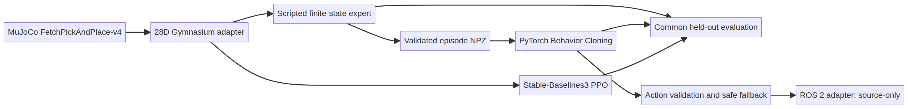
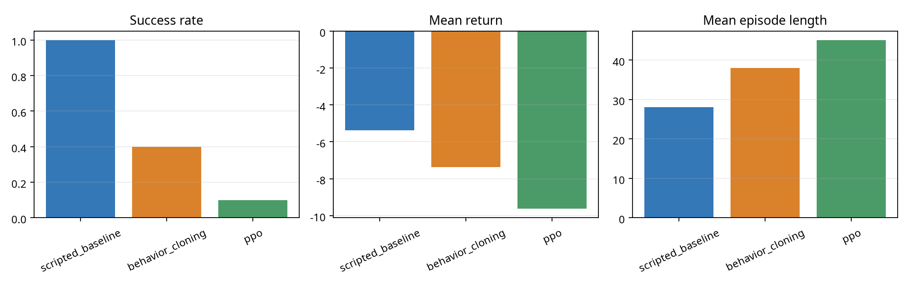

# Robot Learning & Autonomous Manipulation Lab

A reproducible, simulation-only pick-and-place research project using a Fetch robotic arm in MuJoCo through Gymnasium Robotics. It includes a scripted controller, genuine demonstration collection, PyTorch Behavior Cloning, Stable-Baselines3 PPO, common-seed evaluation, safety checks, automated tests, and a separate ROS 2 policy adapter.

**No physical robot deployment is claimed.** ROS 2/Gazebo were not installed in the Manus sandbox; the ROS package is source-only and not runtime-verified. Training used CPU; no GPU was exposed.

## Task and simulator

The environment uses `FetchPickAndPlace-v4` from Gymnasium Robotics, backed by MuJoCo contact dynamics: a simulated Fetch arm with a parallel-jaw gripper moves an object from a randomized starting pose to a target on the work surface. The wrapper does not replace physics or predetermine success.

The policy observation is 28D `float32`: the source Fetch 25D observation (gripper/object state and velocities) plus desired goal XYZ. The action is 4D continuous `float32` in `[-1,1]`: Cartesian gripper delta XYZ and open/close command. Reset uses simulator seeding and the adapter preserves Gymnasium reset/step semantics.

## Architecture



See [`docs/architecture.md`](docs/architecture.md), [`docs/environment.md`](docs/environment.md), [`docs/environment_audit.md`](docs/environment_audit.md), and [`docs/reward_design.md`](docs/reward_design.md) for design details and the measured sandbox capability audit.

## Install and reproduce

Python 3.12 is required by the pinned project metadata. From repository root:

```bash
python -m venv .venv
. .venv/bin/activate
python -m pip install --upgrade pip
pip install -e '.[dev]'
python scripts/collect_demonstrations.py --episodes 40 --seed 7
python scripts/validate_demonstrations.py
python scripts/train_behavior_cloning.py --epochs 100 --seed 7
python scripts/train_ppo.py --timesteps 8192 --n-steps 256 --batch-size 64 --seed 7
python scripts/evaluate_policies.py --episodes 20 --seed-start 1000
python scripts/plot_results.py
python scripts/evaluate_policies.py --episodes 20 --seed-start 1000 --observation-noise-std 0.01 --output experiments/results/robustness_noise_0_01.json
python scripts/run_demo.py --policy expert
pytest -q
```

PPO uses actual environment transitions. Demonstrations are generated online by the scripted expert and stored as compressed NPZ. Dataset validation checks episode boundaries, dimensions, finite values, action bounds, schema version, and labels. BC splits by episode to prevent correlated-timestep leakage. Experiment data, checkpoints, evaluation JSON and console logs from the reported run are included in this repository.

For a no-GUI demonstration, run `python scripts/run_demo.py --policy expert`; add `--render` only where interactive rendering is supported. After training, choose `--policy bc` or `--policy ppo` to run a learned policy.

## Learning methods

The scripted baseline is an interpretable waypoint finite-state expert. BC minimizes action mean-squared error with observation normalization and selects the checkpoint with the best episode-held-out validation loss. PPO uses Stable-Baselines3's clipped PPO, MLP policy/value networks, GAE, and the environment's dense object-to-goal distance reward. No extra handcrafted reward terms are added.

## Measured results

The [experiment report](experiments/results/experiment_report.md) describes the actual environment, seed ranges, metrics, and caveats. In brief, 40 expert episodes produced 1,276 transitions and all 40 succeeded. BC trained for 100 epochs with final reported train MSE 0.018944 and best validation MSE 0.027490 (1,017 train / 259 validation samples). PPO trained for 8,192 actual simulator timesteps on CPU; the short run showed low rollout success and is **not evidence of convergence**.

All policies were evaluated on the same 20 held-out randomized reset seeds (1000–1019), capped at 50 steps:

| Policy | Success | Mean episode seconds | Mean steps | Lift proxy | Drop estimate | Mean dense return |
|---|---:|---:|---:|---:|---:|---:|
| Scripted baseline | 20/20 (100%) | 0.0487 | 28.05 | 18/20 (90%) | 0/20 | -5.3799 |
| Behavior Cloning | 8/20 (40%) | 0.0859 | 38.05 | 17/20 (85%) | 12/20 (60%) | -7.3753 |
| PPO | 2/20 (10%) | 0.1006 | 45.10 | 0/20 (0%) | 0/20 | -9.6337 |

With seed-reproducible Gaussian observation noise `std=0.01`, the same seeds yielded success rates 85% scripted, 15% BC, and 10% PPO. The expert materially outperformed both learned policies in this small run. The lift/grasp value is an object-height proxy; drop is inferred, and collision rate is omitted because no validated collision counter exists. Episode times are measured wall-clock in this sandbox and are not simulator-time metrics.



## ROS 2 and safety

`ros2_ws/src/robot_policy` is a ROS 2 Jazzy Python source package that consumes a 28-value `Float32MultiArray` and publishes a 4-value normalized action. It includes a launch file and parameter YAML. The sandbox had no ROS 2 runtime, so this package is **not built or runtime-tested**. The action validator and open-gripper/zero-motion fallback are simulation-interface safeguards, not certified physical-robot safety. See [`docs/ros2_integration.md`](docs/ros2_integration.md).

## Feature status

| Feature | Status |
|---|---|
| MuJoCo Fetch manipulation environment and scripted expert | Implemented and runtime-tested |
| Dataset generation, validation, serialization | Implemented and runtime-tested; 40 episodes committed |
| Behavior Cloning training and checkpoint inference | Implemented and runtime-tested; 100 epochs, checkpoint included |
| PPO training and checkpoint inference | Implemented and runtime-tested; 8,192 CPU timesteps, checkpoint included |
| Held-out comparison and observation-noise test | Implemented and runtime-tested; 20 episodes per policy per condition |
| Tests and Ruff checks | 7 pytest tests passed; Ruff lint/format and compileall passed; scripted demo passed (seed 17, 26 steps) |
| ROS 2 policy node/launch/config | Implemented source-only; not runtime-tested (ROS 2 unavailable) |
| Gazebo integration / physical hardware / sim-to-real | Not implemented / unavailable |

## Repository layout and license

`src/robot_learning/` contains the environment, expert, data, BC, PPO, evaluation, and safety modules. `scripts/` holds the runnable CLI tools; `configs/` holds training/environment defaults; `tests/` tests the core pipeline; `ros2_ws/src/` contains the isolated ROS 2 adapter; `docs/` documents architecture, task, reward, training, evaluation, ROS status, and limitations; and `experiments/` holds genuine generated artifacts and reports.

MIT license; see [`LICENSE`](LICENSE).
