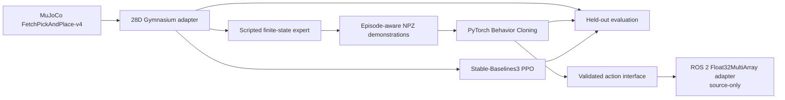

# Architecture

The simulator adapter translates the Fetch goal dictionary into a fixed 28D float vector: the 25D Fetch state observation followed by the desired goal XYZ. The simulator continues to own the physical state; the learned policy sees only this observation and emits the 4D normalized Cartesian delta/gripper action. PPO, BC inference, and the scripted baseline share the same external action limits.

The baseline is a waypoint finite-state policy implemented against the live gripper/object positions. It collects demonstration transitions directly from MuJoCo. BC uses episode-level held-out validation so adjacent timesteps from an episode cannot leak between train and validation. PPO uses SB3's implementation and on-policy environment interaction. Evaluation resets each policy and simulator with the same held-out seeds and writes per-episode outcomes before aggregating.

ROS 2 is deliberately separated from the core Python package. Its node contract is a 28-element `Float32MultiArray` observation and 4-element normalized action. ROS 2 was absent from the audit, so the package is source-only until built and exercised in a ROS 2 workspace.
